<div align="center">

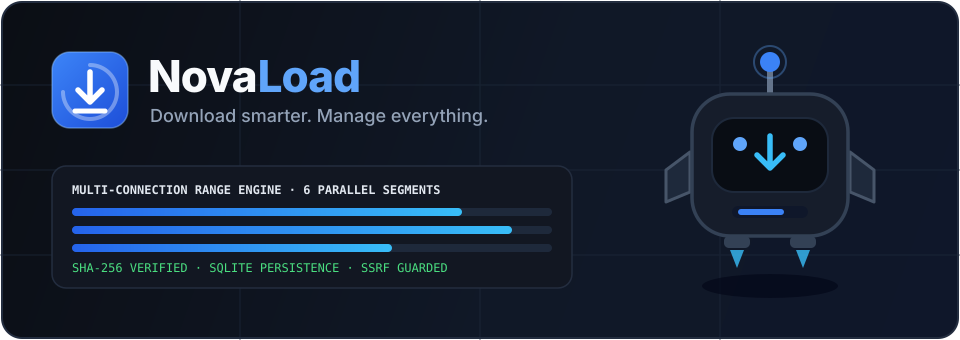

<br />


<h3>Download smarter. Manage everything.</h3>

<p>
  Open-source multi-connection HTTP/HTTPS download manager, persistent SQLite queue scheduler, SHA-256/512 integrity verifier, browser handoff bridge, and optional Gemini AI file organizer.
</p>

<p>
  <a href="./LICENSE"></a>
  <a href="./docs/README.md"></a>
  = 22.5" />
  
  
</p>

<p>
  <a href="#download-novaload"><strong>Download</strong></a> ·
  <a href="#installation"><strong>Build from Source</strong></a> ·
  <a href="./docs/README.md"><strong>Documentation</strong></a> ·
  <a href="#feature-showcase"><strong>Features</strong></a> ·
  <a href="#architecture-overview"><strong>Architecture</strong></a> ·
  <a href="./SECURITY.md"><strong>Security Policy</strong></a> ·
  <a href="./CONTRIBUTING.md"><strong>Contributing</strong></a>
</p>

</div>

---

## What Is NovaLoad?

**NovaLoad** is an open-source download manager and file management workspace built for developers, power users, researchers, and media archivists who want transparent network control without telemetry, adware, or fragile closed-source binaries.

### Why NovaLoad?
- **Browser download bars lack control**: No byte-range multi-connection splitting, no per-queue speed shaping, and no built-in cryptographic checksum comparison.
- **Legacy download managers lack modern architecture**: Older tools rely on brittle single-OS UI toolkits, silent file overwrites, or opaque background processes.
- **Safety first**: NovaLoad enforces strict SSRF URL blocking at every HTTP redirect hop, contains every filesystem operation inside its managed downloads directory, never executes downloaded binaries, and isolates optional Gemini AI features behind a **Preview & Confirm** checklist.

---

## Implementation Transparency

NovaLoad clearly separates what runs today from packaging targets and explicit non-goals:

| Tier | Capabilities | Details |
| :--- | :--- | :--- |
| **Implemented & Verified** | Multi-connection HTTP/HTTPS engine (`1–16`), Range-ignored 200 consolidation, WAL SQLite persistence (`node:sqlite`), pause/resume, exponential retries, SHA-256/512 hashing, queues, scheduler, auto-categorization, file/duplicate manager, DNS-rebinding & symlink guards, desktop standalone SEA sidecar (`novaload-server`), 4 self-contained Manifest V3 extensions + ZIPs, companion CLI, Dark/Light/System themes, EN/FA/AR RTL, optional server-side `@google/genai` assistant | Runnable via Node.js `>= 22.5` or compiled standalone Linux sidecar binary (`npm run build:sidecar`), verified by Vitest security, integration, sidecar E2E, extension, and UI suites |
| **Release CI Desktop Packaging** | Tauri 2 + Rust shell (`src-tauri/`) auto-spawning the embedded `novaload-server` sidecar on dynamic localhost port, system tray, OS keyring helpers, signature-enforced updater, 6-target GitHub Actions release matrix + `SHA256SUMS.txt` + SBOM | Native `.exe`/`.msi`/`.dmg`/`.AppImage`/`.deb`/`.rpm` installers build cleanly in `.github/workflows/release.yml` upon pushing tag `v*` (requires OS/Tauri signing secrets for signed public releases) |
| **Unsupported by Design** | DRM decryption, gated/paywalled stream bypass, BitTorrent/Magnet, automatic execution of downloads | Out of scope — see [Known Limitations](./docs/reference/known-limitations.md) |

---

## Animated Transfer & Security Showcase

> GitHub READMEs strip inline `<script>` tags and can throttle SVG CSS keyframes inside `` proxies. Below we embed verified multi-frame `.gif` previews rendered directly from our vector specs alongside links to the editable animated `.svg` sources and `-static.svg` fallbacks.

<table>
  <tr>
    <td align="center" width="50%">
      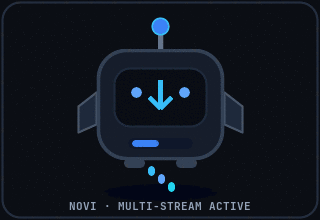
      <br />
      <strong>Novi Active Transfer</strong><br />
      <sub><a href="./assets/animations/downloading-mascot.svg">Editable SVG</a> · <a href="./assets/animations/downloading-mascot-static.svg">Static Fallback</a></sub>
    </td>
    <td align="center" width="50%">
      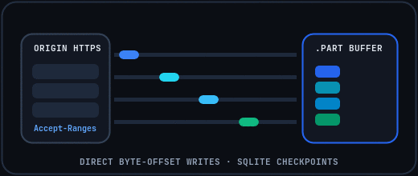
      <br />
      <strong>Segmented Byte-Offset Writes</strong><br />
      <sub><a href="./assets/animations/file-transfer.svg">Editable SVG</a> · <a href="./assets/animations/file-transfer-static.svg">Static Fallback</a></sub>
    </td>
  </tr>
  <tr>
    <td align="center" width="50%">
      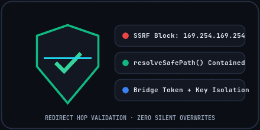
      <br />
      <strong>SSRF & Path Containment Guard</strong><br />
      <sub><a href="./assets/animations/security-shield.svg">Editable SVG</a> · <a href="./assets/animations/security-shield-static.svg">Static Fallback</a></sub>
    </td>
    <td align="center" width="50%">
      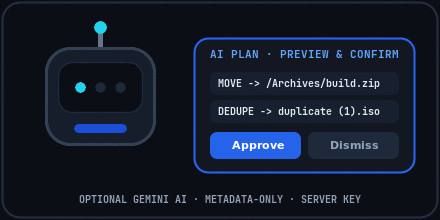
      <br />
      <strong>Optional Gemini AI (Preview & Confirm)</strong><br />
      <sub><a href="./assets/animations/ai-assistant.svg">Editable SVG</a> · <a href="./assets/animations/ai-assistant-static.svg">Static Fallback</a></sub>
    </td>
  </tr>
  <tr>
    <td align="center" width="50%">
      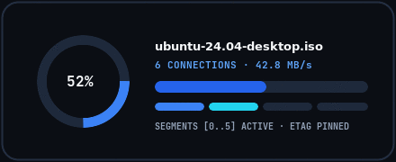
      <br />
      <strong>Live Telemetry & Segment Ring</strong><br />
      <sub><a href="./assets/animations/progress-indicator.svg">Editable SVG</a> · <a href="./assets/animations/progress-indicator-static.svg">Static Fallback</a></sub>
    </td>
    <td align="center" width="50%">
      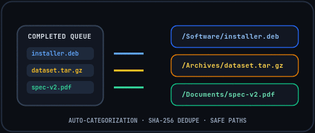
      <br />
      <strong>Automatic Extension Categorization</strong><br />
      <sub><a href="./assets/animations/file-organization.svg">Editable SVG</a> · <a href="./assets/animations/file-organization-static.svg">Static Fallback</a></sub>
    </td>
  </tr>
  <tr>
    <td align="center" width="50%">
      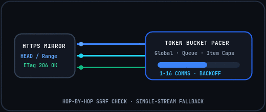
      <br />
      <strong>TokenBucket Speed Shaping</strong><br />
      <sub><a href="./assets/animations/network-connection.svg">Editable SVG</a> · <a href="./assets/animations/network-connection-static.svg">Static Fallback</a></sub>
    </td>
    <td align="center" width="50%">
      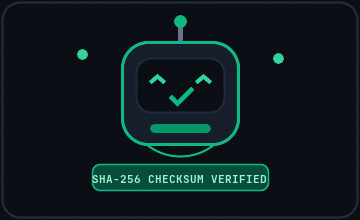
      <br />
      <strong>Verified Checksum Completion</strong><br />
      <sub><a href="./assets/animations/success-celebration.svg">Editable SVG</a> · <a href="./assets/animations/success-celebration-static.svg">Static Fallback</a></sub>
    </td>
  </tr>
</table>

---

## Feature Showcase

<table>
  <tr>
    <td width="50%" valign="top">
      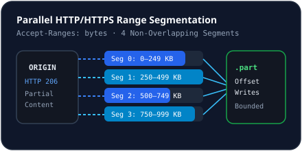
      <h4>Multi-Connection Acceleration & Fallback</h4>
      <p>Probes origins with <code>HEAD</code> (or <code>GET Range: bytes=0-0</code>) and partitions transfers across <code>1–16</code> parallel byte-range connections into <code>.part</code> storage—automatically falling back to a single stream if Range requests are unsupported.</p>
    </td>
    <td width="50%" valign="top">
      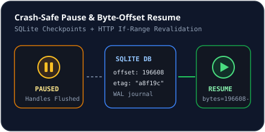
      <h4>Persistent Pause, Resume & Auto-Retry</h4>
      <p>Saves segment byte offsets and <code>ETag</code> headers inside WAL-mode SQLite. Pausing or unexpected shutdown recovers cleanly without losing downloaded ranges, backed by exponential retry backoff.</p>
    </td>
  </tr>
  <tr>
    <td width="50%" valign="top">
      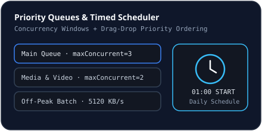
      <h4>Priority Queues, Scheduler & Speed Limits</h4>
      <p>Manage multiple priority queues with drag-and-drop reordering, timed queue start/pause/limit rules, and three-tier <code>TokenBucketPacer</code> bandwidth caps (global, queue, and per-download).</p>
    </td>
    <td width="50%" valign="top">
      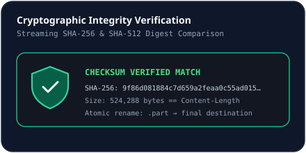
      <h4>SHA-256 / SHA-512 Verification & Categorization</h4>
      <p>Automatically sorts completed files by extension (<code>/Software</code>, <code>/Archives</code>, <code>/Documents</code>, <code>/Video</code>, <code>/Audio</code>, <code>/Images</code>) and streams completed files through SHA-256 and SHA-512 hash verification.</p>
    </td>
  </tr>
  <tr>
    <td width="50%" valign="top">
      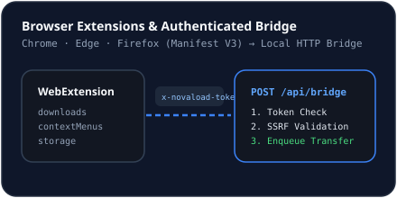
      <h4>Brave, Chrome, Edge & Firefox Browser Bridge</h4>
      <p>Self-contained Manifest V3 extensions (<code>extensions/brave</code>, <code>chrome</code>, <code>edge</code>, <code>firefox</code>) add <em>Download with NovaLoad</em> context menus, <strong>Test Connection</strong> checks, and optional interception over a rotatable <code>x-novaload-token</code> local bridge.</p>
    </td>
    <td width="50%" valign="top">
      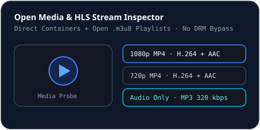
      <h4>Open Media & Video Downloader</h4>
      <p>Inspects direct MP4/WebM/MP3 sources and open HLS (<code>.m3u8</code>) variant playlists to queue preferred resolutions or audio-only tracks—strictly respecting DRM and platform terms.</p>
    </td>
  </tr>
  <tr>
    <td width="50%" valign="top">
      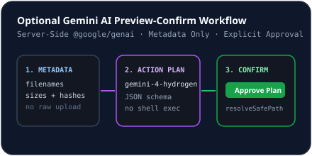
      <h4>Optional Gemini AI File Assistant</h4>
      <p>100% optional server-side <code>@google/genai</code> assistant that analyzes sanitized local metadata to spot duplicates and suggest folder cleanups behind a strict Preview &amp; Confirm workflow.</p>
    </td>
    <td width="50%" valign="top">
      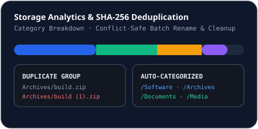
      <h4>Disk Inventory, CLI & Cross-Platform Core</h4>
      <p>Browse downloaded files, detect SHA-256 duplicates, control transfers via <code>cli/novaload.ts</code>, or package native Windows, Linux, and macOS builds via <code>src-tauri/</code>.</p>
    </td>
  </tr>
</table>

---

## Meet Novi — The NovaLoad Mascot

Novi communicates transfer status cleanly across dark and light interfaces:

| Default | Happy | Downloading | Thinking |
| :---: | :---: | :---: | :---: |
|  |  |  |  |
| `mascot-default.svg` | `mascot-happy.svg` | `mascot-downloading.svg` | `mascot-thinking.svg` |

| Error | Success | Idle / Sleep | Security |
| :---: | :---: | :---: | :---: |
|  |  |  |  |
| `mascot-error.svg` | `mascot-success.svg` | `mascot-idle.svg` | `mascot-security.svg` |

See [Novi Mascot Guidelines](./docs/design/mascot-guidelines.md) for usage and design continuity rules.

---

## Screenshots & UI Showcase

NovaLoad's UI includes Dashboard KPI telemetry, live bandwidth graphs, dense table and card download views, an interactive byte-range segment & checksum drawer, queue/scheduler managers, media probe, file duplicate manager, dark/light themes, and English/Persian/Arabic RTL support.

> **Honest Status Notice**: Live UI screenshots are **not fabricated or mocked** in this repository. This documentation update was completed inside a headless container without Chromium, Playwright, or a display server available to capture live browser renders.
>
> Review [`assets/screenshots/README.md`](./assets/screenshots/README.md) for the exact screenshot checklist and instructions for capturing real screenshots from a running local instance (`http://localhost:3000`).

---

## Download NovaLoad

Download ready-to-run desktop installers and browser extension packages from [GitHub Releases](https://github.com/Developer04ZF/NovaLoad/releases) (generated by [`.github/workflows/release.yml`](./.github/workflows/release.yml) when tagging a release). Desktop packages bundle an embedded standalone `novaload-server` executable—**no external Node.js installation is required**.

### Desktop Installers (Windows, macOS, Linux)

| Platform | Architectures | Formats | Guide |
| :--- | :--- | :--- | :--- |
| **Windows 10 / 11** | `x64`, `ARM64` | `.exe` (NSIS Installer), `.msi` | [Platform Support](./docs/releases/platform-support.md) |
| **macOS 11+** | Apple Silicon (`aarch64`), Intel (`x86_64`) | `.dmg`, `.app.tar.gz` | [Platform Support](./docs/releases/platform-support.md) |
| **Linux** | `x64`, `ARM64` | `.AppImage`, `.deb`, `.rpm` | [Platform Support](./docs/releases/platform-support.md) |

### Browser Extensions (Manifest V3)

| Browser | Release ZIP Package | Unpacked Directory | Install Steps |
| :--- | :--- | :--- | :--- |
| **Brave** | `NovaLoad-Brave-Extension-v1.0.0.zip` | `extensions/brave/` | [Browser Extensions Guide](./docs/releases/browser-extensions.md) |
| **Google Chrome** | `NovaLoad-Chrome-Extension-v1.0.0.zip` | `extensions/chrome/` | [Chrome Setup](./docs/integrations/chrome.md) |
| **Microsoft Edge** | `NovaLoad-Edge-Extension-v1.0.0.zip` | `extensions/edge/` | [Edge Setup](./docs/integrations/edge.md) |
| **Mozilla Firefox** | `NovaLoad-Firefox-Extension-v1.0.0.zip` | `extensions/firefox/` | [Firefox Setup](./docs/integrations/firefox.md) |

### Verify Checksums & Release Docs
Every tagged release includes `SHA256SUMS.txt` and `novaload-sbom.spdx.json`:
```bash
sha256sum -c SHA256SUMS.txt --ignore-missing
```
Explore [Releases Overview](./docs/releases/README.md) · [Code Signing & Trust](./docs/releases/code-signing.md) · [Updating NovaLoad](./docs/releases/updating.md) · [Release Checklist](./docs/releases/release-checklist.md).

---

## Installation

### Prerequisites (Source / CLI Development)
- **Node.js `>= 22.5.0`** (uses built-in `node:sqlite`)
- **npm `>= 10`**
- **Optional (Native Tauri 2 Desktop Packaging)**: Stable Rust (`rustup`), `cargo install tauri-cli`, plus OS WebView dependencies.

### Run Locally from Source (Windows, Linux, macOS)

```bash
git clone https://github.com/Developer04ZF/NovaLoad.git
cd NovaLoad
npm install
npm run dev
```

Open **`http://localhost:3000`**. On first launch, NovaLoad initializes `.novaload/novaload.db`, creates `.novaload/downloads/`, and generates a random local browser bridge token.

To build and serve production frontend assets:

```bash
npm run build
NODE_ENV=production npm start
```

### Platform-Specific Packaging (`src-tauri/`)
- **Windows (10/11 — `x64`, `ARM64`)**: Build NSIS `.exe` / `.msi` installers with MSVC Build Tools + WebView2 Runtime — see [Windows Packaging](./docs/deployment/windows.md).
- **Linux (`x64`, `ARM64`)**: Install `libwebkit2gtk-4.1-dev libappindicator3-dev librsvg2-dev patchelf rpm` and build `.AppImage` / `.deb` / `.rpm` — see [Linux Packaging](./docs/deployment/linux.md).
- **macOS (`Apple Silicon`, `Intel`)**: Build `.dmg` / `.app.tar.gz` bundles with Xcode Command Line Tools — see [macOS Packaging](./docs/deployment/macos.md).

### Companion CLI (`cli/novaload.ts`)

```bash
npx tsx cli/novaload.ts version
npx tsx cli/novaload.ts download http://127.0.0.1:3000/api/fixtures/file/novaload-linux-x64.tar.gz --connections 6
npx tsx cli/novaload.ts list
npx tsx cli/novaload.ts pause <ID>
npx tsx cli/novaload.ts resume <ID>
```

For environment variables (`PORT`, `NOVALOAD_DATA_DIR`, `GEMINI_API_KEY`, `NOVALOAD_API_URL`) and troubleshooting, see [Installation Guide](./docs/getting-started/installation.md) and [Deployment Troubleshooting](./docs/deployment/troubleshooting.md).

---

## Architecture Overview

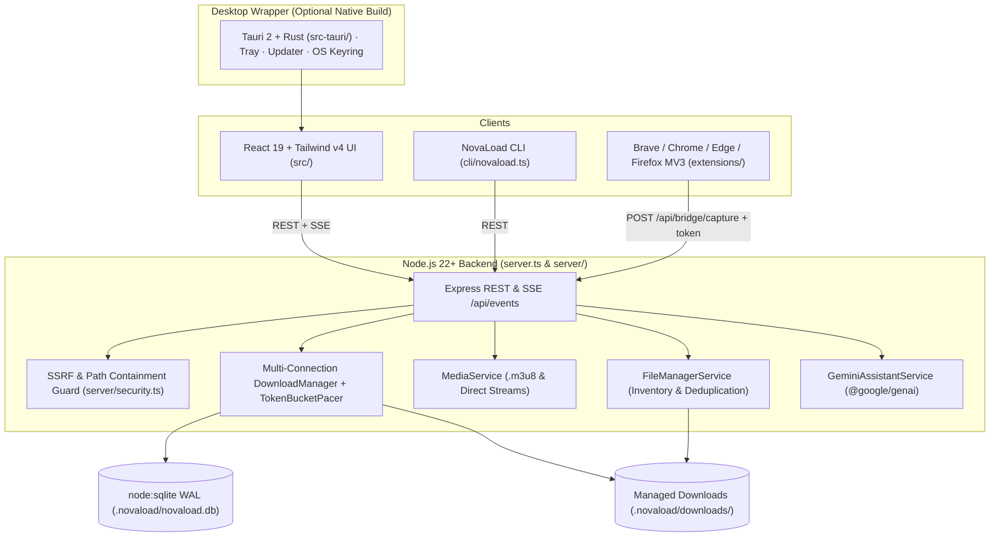

## Technology Stack

| Layer | Technology | Responsibility |
| :--- | :--- | :--- |
| **Frontend UI** | React 19, Vite 8, TypeScript, Tailwind CSS v4, `lucide-react`, `motion` | Responsive multi-view workspace, dark/light themes, EN/FA/AR RTL localization, live SSE charts |
| **Backend API** | Express 4, Zod 4, Server-Sent Events | Input validation, REST endpoints, deterministic local fixtures, real-time `snapshot` stream |
| **Download Engine** | Node.js `fetch` streams, `fs/promises`, `node:crypto`, `TokenBucketPacer` | Parallel byte-range writes, automatic fallback, rate limiting, exponential retries, SHA-256/512 hashing |
| **Persistence** | Node.js built-in `node:sqlite` (`DatabaseSync` WAL mode) | Versioned schema migrations, segment checkpoints, queue/schedule config, integrity checks |
| **Desktop Shell** | Tauri 2, Rust (`reqwest`, `tokio`, `sha2`, `keyring`) | Native windows, embedded Node 22 SEA sidecar runner, tray, OS keyring, signature-enforced updater |
| **Browser Integration** | Manifest V3 (`extensions/{brave,chrome,edge,firefox}/`) | Self-contained MV3 extensions + release ZIPs via token-authenticated `/api/bridge/capture` |
| **Optional AI** | `@google/genai` (server-side only) | Metadata-only file organization plans presented in a Preview & Confirm dialog |
| **Verification** | Vitest 5, Testing Library, TypeScript `tsc`, `scripts/validate-*.mjs` | Security unit, integration, sidecar E2E, extension, React UI, version, and docs checks |

---

## Documentation Hub

Explore the structured knowledge base under [`docs/`](./docs/README.md):

- **Getting Started**: [Introduction](./docs/getting-started/introduction.md) · [Installation](./docs/getting-started/installation.md) · [First Download](./docs/getting-started/first-download.md) · [Configuration](./docs/getting-started/configuration.md) · [Upgrading](./docs/getting-started/upgrading.md) · [Uninstalling](./docs/getting-started/uninstalling.md)
- **Releases & Distribution**: [Releases Overview](./docs/releases/README.md) · [Platform Support](./docs/releases/platform-support.md) · [Browser Extensions](./docs/releases/browser-extensions.md) · [Building Releases](./docs/releases/building-releases.md) · [Code Signing](./docs/releases/code-signing.md) · [Updating](./docs/releases/updating.md) · [Release Checklist](./docs/releases/release-checklist.md)
- **User Guide**: [Dashboard](./docs/user-guide/dashboard.md) · [Downloads](./docs/user-guide/downloads.md) · [Multi-Connection](./docs/user-guide/multi-connection.md) · [Queues](./docs/user-guide/queues.md) · [Scheduler](./docs/user-guide/scheduler.md) · [Speed Limits](./docs/user-guide/speed-limits.md) · [File Manager](./docs/user-guide/file-management.md) · [Browser Integration](./docs/user-guide/browser-integration.md) · [Video Downloader](./docs/user-guide/video-downloader.md) · [AI Assistant](./docs/user-guide/ai-assistant.md)
- **Architecture & Engine**: [System Overview](./docs/architecture/overview.md) · [Database Schema](./docs/architecture/database.md) · [Range Engine](./docs/download-engine/overview.md) · [Integrity Verification](./docs/download-engine/integrity-verification.md)
- **Developers & Security**: [REST & SSE API Reference](./docs/developer-guide/api-reference.md) · [Testing](./docs/developer-guide/testing.md) · [Security Model](./docs/security/security-model.md) · [SSRF Protection](./docs/security/ssrf-protection.md) · [Threat Model](./docs/security/threat-model.md)
- **Deployment & Reference**: [Production Builds](./docs/deployment/production-builds.md) · [GitHub Actions CI/CD](./docs/deployment/github-actions.md) · [Environment Variables](./docs/reference/environment-variables.md) · [FAQ](./docs/reference/faq.md)

---

## Verification Commands

```bash
npm run lint              # TypeScript type-check (tsc --noEmit)
npm test                  # Security unit, engine integration, sidecar E2E, extension & UI tests
npm run build             # Production Vite SPA bundle
npm run build:extensions  # Package Brave, Chrome, Edge & Firefox MV3 ZIP archives
npm run build:sidecar     # Build standalone Node 22 SEA backend executable
npm run validate:release  # Validate versions, extension ZIPs, artifacts & Markdown/SVG docs
```

---

## Contributing, Security & Governance

- **Contributing**: See [`CONTRIBUTING.md`](./CONTRIBUTING.md), [`CODE_OF_CONDUCT.md`](./CODE_OF_CONDUCT.md), and [`ROADMAP.md`](./ROADMAP.md).
- **Support**: Review [`SUPPORT.md`](./SUPPORT.md) and [FAQ](./docs/reference/faq.md).
- **Security**: Report vulnerabilities privately via GitHub Security Advisories or `security@novaload.org` following [`SECURITY.md`](./SECURITY.md).

## License & Attribution

- **Source Code**: [Apache License 2.0](./LICENSE)
- **Documentation & Visual Assets**: Creative Commons Attribution 4.0 International (CC BY 4.0)
- **Notices & Dependencies**: [`NOTICE`](./NOTICE), [`THIRD_PARTY_LICENSES.md`](./THIRD_PARTY_LICENSES.md), [`AUTHORS.md`](./AUTHORS.md), and [`CHANGELOG.md`](./CHANGELOG.md).
