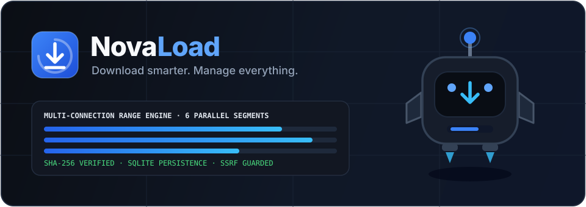

# NovaLoad Documentation Knowledge Base

Welcome to the official documentation for **NovaLoad** — *"Download smarter. Manage everything."* (documentation licensed under CC BY 4.0).

Every page in this knowledge base documents verified code paths, commands, API routes, and architectural boundaries present in `Developer04ZF/NovaLoad`. Where capabilities are configured for native desktop CI packaging (`src-tauri/`) rather than active inside headless web mode, this distinction is noted explicitly.

---

## Documentation Index

### 1. Getting Started
- [Introduction & Feature Matrix](./getting-started/introduction.md)
- [Installation Guide (Windows, Linux, macOS, Node 22+)](./getting-started/installation.md)
- [Your First Download & Integrity Check](./getting-started/first-download.md)
- [Configuration & Environment Setup](./getting-started/configuration.md)
- [Upgrading NovaLoad & Database Migrations](./getting-started/upgrading.md)
- [Uninstalling & Clean Removal](./getting-started/uninstalling.md)

### 2. User Guide
- [Dashboard & Telemetry](./user-guide/dashboard.md)
- [Managing Downloads](./user-guide/downloads.md)
- [Multi-Connection Acceleration](./user-guide/multi-connection.md)
- [Pause, Resume & Retries](./user-guide/pause-resume.md)
- [Priority Queues](./user-guide/queues.md)
- [Timed Scheduler](./user-guide/scheduler.md)
- [Bandwidth & Speed Limits](./user-guide/speed-limits.md)
- [File Management & Duplicate Detection](./user-guide/file-management.md)
- [Automatic Categorization](./user-guide/categories.md)
- [Browser Integration](./user-guide/browser-integration.md)
- [Open Media & Video Downloader](./user-guide/video-downloader.md)
- [Gemini AI Assistant](./user-guide/ai-assistant.md)
- [Application Settings & Localization](./user-guide/settings.md)
- [Keyboard Shortcuts](./user-guide/keyboard-shortcuts.md)

### 3. Architecture
- [Architecture Overview](./architecture/overview.md)
- [System Design & Runtime Modes](./architecture/system-design.md)
- [React Frontend Architecture](./architecture/frontend.md)
- [Express Backend & SSE Stream](./architecture/backend.md)
- [Tauri 2 Desktop Integration](./architecture/tauri-integration.md)
- [Download Engine Internals](./architecture/download-engine.md)
- [SQLite Database Schema & WAL Mode](./architecture/database.md)
- [Browser Extension Bridge](./architecture/browser-bridge.md)
- [Server-Side Gemini AI Integration](./architecture/ai-integration.md)
- [Security Architecture](./architecture/security-architecture.md)
- [End-to-End Data Flow](./architecture/data-flow.md)

### 4. Download Engine Deep Dive
- [Engine Overview](./download-engine/overview.md)
- [HTTP & HTTPS Transport](./download-engine/http-https.md)
- [Range Request Negotiation](./download-engine/range-requests.md)
- [Segmented Downloads](./download-engine/segmented-downloads.md)
- [Retry & Exponential Backoff System](./download-engine/retry-system.md)
- [Pause & Resume Mechanism](./download-engine/resume-mechanism.md)
- [Cryptographic Integrity Verification](./download-engine/integrity-verification.md)
- [Token Bucket Bandwidth Control](./download-engine/bandwidth-control.md)
- [Error Handling & Diagnostics](./download-engine/error-handling.md)
- [Engine Scope & Limitations](./download-engine/limitations.md)

### 5. Developer Guide
- [Development Environment Setup](./developer-guide/development-environment.md)
- [Repository & Project Structure](./developer-guide/project-structure.md)
- [Coding Standards](./developer-guide/coding-standards.md)
- [Frontend Development](./developer-guide/frontend-development.md)
- [Backend Development](./developer-guide/backend-development.md)
- [Rust & Tauri Development](./developer-guide/rust-development.md)
- [Database Migrations](./developer-guide/database-migrations.md)
- [REST & SSE API Reference](./developer-guide/api-reference.md)
- [Testing & Verification](./developer-guide/testing.md)
- [Debugging & Local Fixtures](./developer-guide/debugging.md)
- [Adding New Features](./developer-guide/adding-features.md)
- [Adding Download Protocols](./developer-guide/adding-download-protocols.md)
- [Building Bundles & Documentation Validation](./developer-guide/building.md)

### 6. Integrations
- [Browser Extensions Overview](./integrations/browser-extensions.md)
- [Google Chrome Setup](./integrations/chrome.md)
- [Microsoft Edge Setup](./integrations/edge.md)
- [Mozilla Firefox Setup](./integrations/firefox.md)
- [Gemini AI Configuration](./integrations/gemini-ai.md)
- [API & CLI Integration](./integrations/api-configuration.md)

### 7. Security & Privacy
- [Security Model](./security/security-model.md)
- [SSRF Protection](./security/ssrf-protection.md)
- [Filesystem Security & Path Containment](./security/filesystem-security.md)
- [Secrets Management](./security/secrets-management.md)
- [Privacy & Telemetry Policy](./security/privacy.md)
- [Threat Model](./security/threat-model.md)

### 8. Deployment & Releases
- [Production Builds Overview](./deployment/production-builds.md)
- [Windows Packaging](./deployment/windows.md)
- [Linux Packaging](./deployment/linux.md)
- [macOS Packaging](./deployment/macos.md)
- [GitHub Actions CI/CD](./deployment/github-actions.md)
- [Release Process & Signing](./deployment/release-process.md)
- [Deployment Troubleshooting](./deployment/troubleshooting.md)

### 9. Design & Brand System
- [Brand Guidelines](./design/brand-guidelines.md)
- [Novi Mascot Guidelines](./design/mascot-guidelines.md)
- [UI Design System & Color Tokens](./design/design-system.md)
- [SVG & Animation Guidelines](./design/illustration-guidelines.md)
- [Accessibility & RTL Support](./design/accessibility.md)

### 10. Reference
- [Glossary](./reference/glossary.md)
- [Environment Variables](./reference/environment-variables.md)
- [Configuration & Settings Reference](./reference/configuration-reference.md)
- [Supported Platforms Matrix](./reference/supported-platforms.md)
- [Known Limitations](./reference/known-limitations.md)
- [Frequently Asked Questions](./reference/faq.md)

### 11. Releases & Distribution
- [Releases Overview](./releases/README.md)
- [Platform Support & Artifacts](./releases/platform-support.md)
- [Building Releases & Standalone Sidecars](./releases/building-releases.md)
- [Browser Extensions Distribution](./releases/browser-extensions.md)
- [Code Signing & Certificates](./releases/code-signing.md)
- [Updating NovaLoad](./releases/updating.md)
- [Release Checklist](./releases/release-checklist.md)
