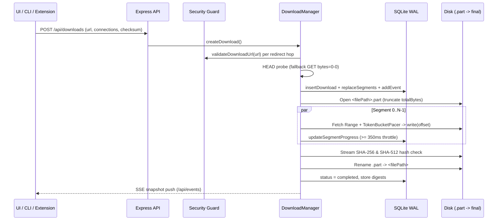

# End-to-End Data Flow

## Transfer Lifecycle Sequence

## Related Documentation
- [Download Engine Overview](../download-engine/overview.md)
- [REST & SSE API Reference](../developer-guide/api-reference.md)
