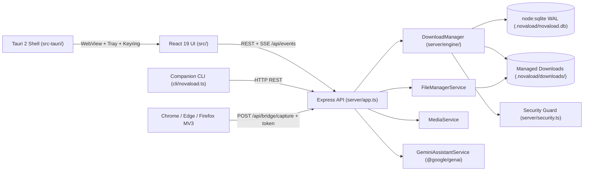

# Architecture Overview

## Purpose
NovaLoad separates interactive UI presentation, REST/SSE orchestration, multi-connection transfer execution, SQLite persistence, and native desktop OS integration into clear layers.

## System Topology

## Core Responsibilities
- **`src/`**: React 19 + TypeScript + Tailwind v4 SPA presenting live snapshots, segment telemetry, queue management, media probe, file manager, and preview-confirm AI workflows.
- **`server/`**: Express HTTP server (`server.ts` + `server/app.ts`) hosting engine routes, deterministic `/api/fixtures/*` endpoints, and server-side `@google/genai` calls.
- **`server/engine/`**: Segmented HTTP/HTTPS `DownloadManager`, `TokenBucketPacer`, scheduler timer, and streaming SHA-256/SHA-512 hashers.
- **`server/db.ts`**: Node `node:sqlite` (`DatabaseSync`) persistence layer with versioned migrations and startup crash recovery.
- **`src-tauri/`**: Rust Tauri 2 desktop shell configuring system tray, notifications, updater, OS keyring helpers, and native Rust engine/security modules (`engine.rs`, `security.rs`).

## Related Documentation
- [System Design & Runtime Modes](./system-design.md)
- [End-to-End Data Flow](./data-flow.md)
