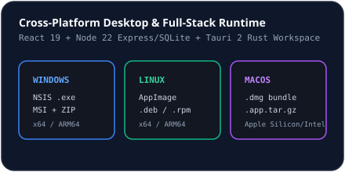

# Tauri 2 Desktop Integration

## Workspace Structure (`src-tauri/`)
- `src-tauri/tauri.conf.json`: Desktop window defaults (`1360x860`, minimum `960x640`), strict CSP (`default-src 'self'; connect-src 'self' http://127.0.0.1:3000; ...`), bundle targets (`all`), NSIS current-user Windows install mode, and updater endpoint (`https://github.com/Developer04ZF/NovaLoad/releases/latest/download/latest.json`).
- `src-tauri/src/lib.rs`: Initializes `tauri_plugin_notification`, `tauri_plugin_updater`, system tray menu (`Open NovaLoad`, `Quit`), and Tauri invoke commands:
  - `validate_url_command`
  - `store_secret_in_keyring`
  - `delete_secret_from_keyring`
- `src-tauri/src/security.rs` & `src-tauri/src/engine.rs`: Rust implementations + unit tests for URL SSRF validation, safe path normalization, range splitting, segment writing, and SHA-256 verification.

## Implementation Scope Distinction
The web/server mode runs completely on Node.js 22+ (`npm run dev`). Compiling native OS desktop installers from `src-tauri/` requires a native Rust toolchain and platform WebView dependencies (or GitHub Actions release runners).

## Related Documentation
- [Rust & Tauri Development](../developer-guide/rust-development.md)
- [Production Builds](../deployment/production-builds.md)
