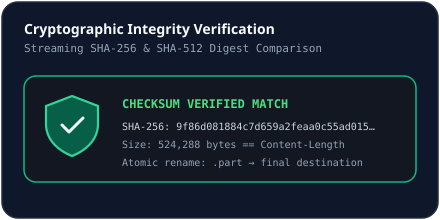

# Cryptographic Integrity Verification

## Completion Verification Pipeline
Once all segments complete, the download transitions to `status: 'verifying'`:
1. `computeHashes(partPath)` reads the assembled `<filePath>.part` file via `fs.createReadStream()`—avoiding buffering whole multi-gigabyte files into RAM—feeding chunks simultaneously into Node `crypto.createHash('sha256')` and `crypto.createHash('sha512')`.
2. **Exact Byte-Size Check**: If `latest.totalBytes > 0` and `byteSize !== latest.totalBytes`, NovaLoad rejects completion with `Size mismatch`.
3. **Optional Expected Checksum Check**: If `expectedChecksum` (`sha256` or `sha512`) was supplied, NovaLoad performs a case-insensitive exact match. Mismatches fail the transfer rather than promoting corrupt files into finished storage.
4. **Atomic Promotion**: `fsp.rename(partPath, latest.filePath)` moves the verified file into place and stores both `actualSha256` and `actualSha512` in SQLite.

## On-Demand Post-Download Verification
Any completed download can be re-hashed or compared against a newly pasted checksum at any time via `POST /api/downloads/:id/verify`.

## Related Documentation
- [Download Details & File Management](../user-guide/file-management.md)
- [Segmented Downloads](./segmented-downloads.md)
