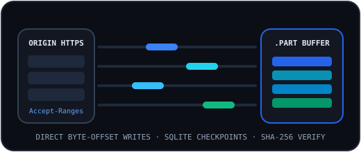

# Download Engine Overview

## Core Responsibilities (`server/engine/downloadManager.ts`)
`DownloadManager` manages every stage of an HTTP/HTTPS download:
1. **SSRF & Redirect Validation** (`validateDownloadUrl`, `fetchWithSafeRedirects`)
2. **Metadata & Range Probing** (`probeUrl`)
3. **Queue & Priority Scheduling** (`dispatchQueuedDownloads`, `evaluateSchedules`)
4. **Segmented / Single-Stream Execution** (`runDownload`, `runSegment`)
5. **Bandwidth Pacing** (`TokenBucketPacer`)
6. **Pause, Resume, Retry & Cancellation**
7. **Streaming Integrity Hashing** (`computeHashes`)

## State Machine
Supported `DownloadStatus` values (`src/shared/types.ts`):
`queued` → `probing` → `downloading` → `verifying` → `completed`, with reversible transitions to `paused`, `failed`, or `cancelled`.

## Related Documentation
- [HTTP & HTTPS Transport](./http-https.md)
- [Segmented Downloads](./segmented-downloads.md)
- [Cryptographic Integrity Verification](./integrity-verification.md)
