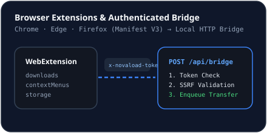

# Browser Extensions Overview

## Architecture
NovaLoad ships Manifest V3 WebExtension sources in:
- `extensions/chrome-edge/` (`manifest.json`, `background.js`, `popup.html`, `popup.js`) for Google Chrome and Microsoft Edge.
- `extensions/firefox/` (`manifest.json` reusing shared extension scripts with Gecko ID `bridge@novaload.org`, `strict_min_version: 115.0`).

## Requested Permissions
Both manifests request the minimum permissions needed to hand off URLs safely:
- `downloads` — optional automatic download interception when **Auto-Intercept** is enabled by the user.
- `contextMenus` — adds **Download with NovaLoad** to right-click menus on `link`, `video`, and `audio` targets.
- `storage` — saves the bridge endpoint and `x-novaload-token` inside extension local storage.
- `host_permissions`: restricted strictly to `http://127.0.0.1:3000/*`.

## Verification
Extensions are unpacked WebExtension source bundles intended to be loaded in developer/unpacked mode or packaged for store distribution; verify pairing via NovaLoad's **Browser Bridge** view (`GET /api/bridge/status`).

## Related Documentation
- [Google Chrome Setup](./chrome.md)
- [Microsoft Edge Setup](./edge.md)
- [Mozilla Firefox Setup](./firefox.md)
- [Browser Extension Bridge Architecture](../architecture/browser-bridge.md)
