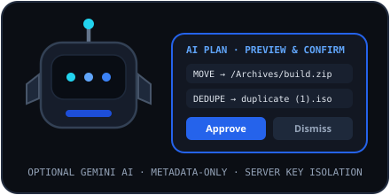

# Gemini AI Configuration

## Server-Side SDK & Key Setup
NovaLoad uses `@google/genai` strictly inside `server/services/geminiService.ts`.
1. Obtain a Gemini API key and set `GEMINI_API_KEY` in `.env` or your runtime environment secrets (never inside `VITE_*` variables or browser localStorage).
2. Restart the NovaLoad server so `process.env.GEMINI_API_KEY` is loaded.
3. Open **AI Assistant** in NovaLoad and click **Test Connection** (`POST /api/ai/test`) to verify latency and model connectivity.

## Supported Models
Configured via `settings.aiModel`:
- `gemini-4-hydrogen` (default)
- `gemini-3.1-flash-lite`

## Guardrails
- `aiRequireConfirmation` (`true` by default): Every suggested file move, rename, or duplicate removal must be reviewed and confirmed by the user.
- `aiAllowFileMetadata` (`true` by default): Shares sanitized filename/path/size/SHA-256-prefix metadata only.
- `aiAllowFileContent` (`false` by default): File contents remain local.

## Related Documentation
- [Gemini AI Assistant User Guide](../user-guide/ai-assistant.md)
- [Secrets Management](../security/secrets-management.md)
