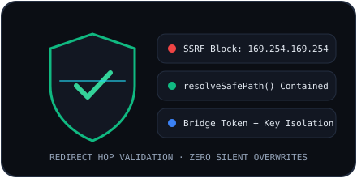

# Security Model

## Security Principles
NovaLoad treats every network URL, HTTP redirect header, server filename, browser extension request, and AI-suggested filesystem mutation as untrusted input. Core mitigations live in `server/security.ts` and `src-tauri/src/security.rs`, verified by `tests/security.test.ts` and Rust unit tests.

## Core Safeguards
1. **SSRF Blocking**: Validates scheme (`http:` / `https:`), forbids embedded URL credentials, and blocks private/loopback/metadata IP ranges at initial probe and every redirect hop.
2. **Filesystem Containment**: Confines every download write, move, rename, and deletion inside `NOVALOAD_DATA_DIR/downloads` via `resolveSafePath()` and `sanitizeFilename()`.
3. **Zero Silent Overwrites**: Collision-safe destination numbering (`name (1).ext`) and explicit rejection when a target file already exists during `FileManagerService` operations.
4. **No Automatic Execution**: Downloaded installers or binaries are never executed by NovaLoad.
5. **Credential Isolation & Redaction**: API keys stay server-side (or OS keyring in Tauri); error strings and backups redact keys and tokens.

## Related Documentation
- [SSRF Protection](./ssrf-protection.md)
- [Filesystem Security](./filesystem-security.md)
- [Threat Model](./threat-model.md)
