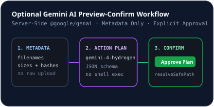

# Gemini AI Assistant

## Strictly Optional Architecture
NovaLoad's core download manager, queues, scheduler, hashing, and file manager work **100% offline/locally without any AI key**. Gemini AI (`server/services/geminiService.ts`) is an optional assistant for organizing downloaded files and answering storage questions.

## How It Works
1. Configure `GEMINI_API_KEY` in the server environment (never sent to browsers).
2. Open **AI Assistant** in NovaLoad (`AiAssistantView.tsx`).
3. Ask natural-language questions (e.g., *"Find large duplicate archives and propose clean subfolders"*).
4. `GeminiAssistantService` sends **sanitized file metadata only** (`filename`, `relativePath`, `category`, `sizeBytes`, `extension`, 12-char `sha256Prefix`, `modifiedAt`, duplicate groups, and recent transfer summaries) to `gemini-4-hydrogen` or `gemini-3.1-flash-lite`.
5. Gemini returns structured JSON containing `summary`, `answer`, and typed `actions` (`move`, `rename`, `delete_duplicate`, `create_folder`).

## Preview & Confirm Guardrail
- No filesystem change runs automatically.
- Proposed actions render in an interactive checklist with risk levels (`low`, `medium`, `high`).
- Only checked actions execute through `POST /api/files/execute-actions` (`FileManagerService.executeApprovedActions`), which enforces `resolveSafePath` containment and refuses overwrites.

## Related Documentation
- [Gemini AI Integration Guide](../integrations/gemini-ai.md)
- [Secrets Management](../security/secrets-management.md)
