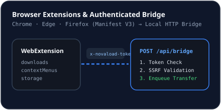

# Browser Integration

## Purpose
Hand off links, media elements, and browser downloads directly from Google Chrome, Microsoft Edge, and Mozilla Firefox into NovaLoad's multi-connection engine.

## Minimal Permissions Model
Both `extensions/chrome-edge/manifest.json` and `extensions/firefox/manifest.json` use Manifest V3 and request only three narrow permissions:
- `downloads` — optional interception when **Auto-Intercept** is enabled in the extension popup.
- `contextMenus` — adds **Download with NovaLoad** to link, video, and audio right-click menus.
- `storage` — stores the local endpoint (`http://127.0.0.1:3000/api/bridge/capture`) and auth token locally.

Host permission is restricted strictly to `http://127.0.0.1:3000/*`. Extensions never inject content scripts into arbitrary websites or read page DOM history.

## Pairing with NovaLoad
1. Open **Browser Bridge** in NovaLoad (`BrowserBridgeAndPluginsView.tsx`).
2. Ensure the bridge is enabled and copy the **Bridge Auth Token** (`nl_bridge_...`).
3. Load the unpacked extension from `extensions/chrome-edge` (Chrome/Edge) or `extensions/firefox` (Firefox), open its popup, and paste the token.
4. Rotate the token at any time via **Rotate Token** (`POST /api/settings/rotate-bridge-token`).

## Related Documentation
- [Chrome Setup](../integrations/chrome.md)
- [Edge Setup](../integrations/edge.md)
- [Firefox Setup](../integrations/firefox.md)
