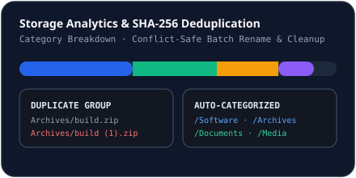

# File Management & Duplicate Detection

## Purpose
Inspect every file inside NovaLoad's managed downloads directory (`.novaload/downloads/` by default), identify exact byte-identical duplicates by SHA-256 hash, and execute safe cleanup operations (`FileManagerView.tsx` & `server/services/fileManager.ts`).

## How Disk Inventory Works
`GET /api/files/inventory` recursively walks `downloadsDir` (excluding active `.part` files and dotfiles), computing:
- `relativePath`, `category` (top-level subfolder), `sizeBytes`, `extension`, `modifiedAt`, and streaming **SHA-256** digest.
- **Duplicate Groups**: Groups files sharing an identical SHA-256 hash so redundant copies can be inspected and pruned safely.

## Path Safety Guarantee
Every action dispatched via `POST /api/files/execute-actions` (`move`, `rename`, `delete_duplicate`, `create_folder`) validates source and target paths through `resolveSafePath`, preventing directory traversal and refusing silent overwrites if a destination already exists.

## Related Documentation
- [Automatic Categorization](./categories.md)
- [Gemini AI Assistant](./ai-assistant.md)
- [Filesystem Security](../security/filesystem-security.md)
