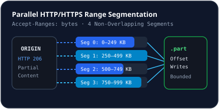

# Multi-Connection Acceleration

## How It Works
When adding a download, NovaLoad inspects server capabilities via `HEAD` (falling back to `GET Range: bytes=0-0` on HTTP `405` or `501`):
- If the server returns `Accept-Ranges: bytes` and `Content-Length >= 65536` (64 KB), `DownloadManager` splits the byte range `[0 .. totalBytes - 1]` across `1..16` parallel `DownloadSegment` workers.
- Each segment streams chunks directly into its assigned byte offset in `<filePath>.part` using `FileHandle.write(chunk, 0, chunk.length, writeOffset)`.

## Automatic Single-Stream Fallback
- If the origin server does not advertise Range support, if `totalBytes < 65536`, or if a secondary segment receives HTTP `200` instead of `206`, NovaLoad automatically falls back to single-stream download mode (`connections = 1`) without corrupting the file.

## Inspecting Segments
Click any row in the downloads list to open `DownloadDetailsDrawer`, displaying per-segment status (`pending`, `active`, `paused`, `completed`, `error`), byte range, downloaded bytes, and instantaneous speed.

## Related Documentation
- [Segmented Downloads Architecture](../download-engine/segmented-downloads.md)
- [Range Request Negotiation](../download-engine/range-requests.md)
