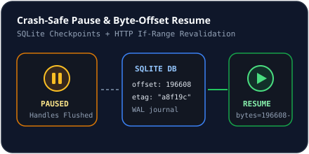

# Pause, Resume & Retries

## Pausing & Resuming Transfers
- **Pause**: Aborts active `AbortController` fetches immediately, sets active segments to `paused`, preserves `downloaded_bytes` in `download_segments` (SQLite), flushes the `.part` file handle, and records an audit event (`download_events`).
- **Crash Recovery**: On server startup (`NovaDatabase.seedDefaults()`), any downloads left in `'downloading'`, `'probing'`, or `'verifying'` state automatically transition to `'paused'` with preserved byte offsets.
- **Resume**: Sends `Range: bytes=<startByte + downloadedBytes>-<endByte>` alongside `If-Range: <etag>` (when an `ETag` was captured) so servers only return HTTP `206` if the file remained unchanged.
- **Non-Range Restart**: For servers without `Accept-Ranges: bytes`, resuming cleanly truncates the partial buffer and restarts from byte `0`, noting this in the download event log.

## Automatic Retries
When `settings.autoRetry` is `true` and an unexpected network error occurs (`retryCount < maxRetries`, default `3`):
- NovaLoad increments `retryCount`, schedules exponential backoff (`Math.min(8000, 1000 * 2 ** nextRetry)` ms), and re-dispatches the item once ready.

## Related Documentation
- [Retry System](../download-engine/retry-system.md)
- [Resume Mechanism](../download-engine/resume-mechanism.md)
