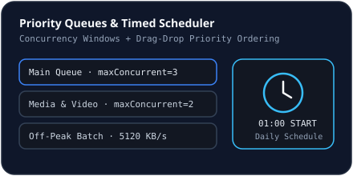

# Priority Queues

## Built-in Default Queues
`NovaDatabase` seeds three default queues on initialization:
1. **`default` (Main Queue)**: `maxConcurrent = 3`, `maxConnectionsPerDownload = 8`, uncapped speed (`isDefault = true`).
2. **`media` (Media & Video)**: `maxConcurrent = 2`, `maxConnectionsPerDownload = 6`, uncapped speed.
3. **`night` (Off-Peak Batch)**: `maxConcurrent = 4`, `maxConnectionsPerDownload = 8`, `speedLimitKbps = 5120` (5 MB/s).

## Customizing & Reordering Queues
Open **Queues** in the sidebar (`QueuesAndSchedulerView.tsx`):
- Create or edit queues with custom concurrency caps, default connection counts, and optional queue-level speed limits (`POST /api/queues`).
- Reorder download priority within a queue via drag-and-drop or up/down priority buttons (`POST /api/queues/reorder`). Higher `priority` items dispatch ahead of lower priority items inside `dispatchQueuedDownloads()`.

## Related Documentation
- [Timed Scheduler](./scheduler.md)
- [Bandwidth & Speed Limits](./speed-limits.md)
