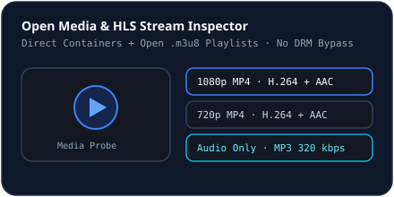

# Open Media & Video Downloader

## Supported Media Inputs
`MediaService` (`server/services/mediaService.ts`) probes open media URLs via `POST /api/media/probe`:
- **Direct Video & Audio Containers**: `mp4`, `webm`, `mkv`, `mov`, `m4v`, `mp3`, `wav`, `ogg`, `flac`, `aac`, `m4a` (and `video/*` or `audio/*` MIME types).
- **Open HLS Playlists (`.m3u8` / `mpegurl`)**: Parses `#EXT-X-STREAM-INF:` variant lines to list available `RESOLUTION` and `BANDWIDTH` streams.
- **Deterministic Local Fixtures (`/api/fixtures/video/...`)**: Exposes `1080p` MP4, `720p` MP4, and `MP3 320kbps` audio-only tracks for instant local testing.

## Ethical & Technical Boundaries
- NovaLoad **does not bypass DRM**, encrypted media keys, paywalls, or gated HTML streaming pages (`drmProtected` / non-stream warning returned cleanly when no direct stream exists).
- When multiple variants exist, you pick the desired quality/audio track in **Video & Media** and enqueue it as a managed download.

## Related Documentation
- [Managing Downloads](./downloads.md)
- [Known Limitations](../reference/known-limitations.md)
